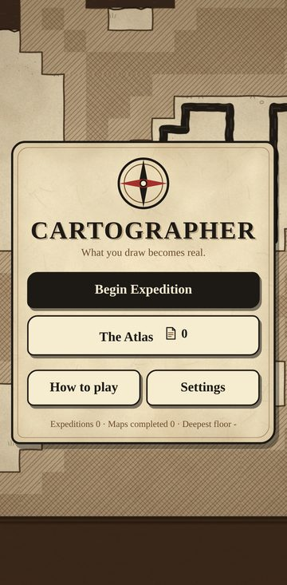
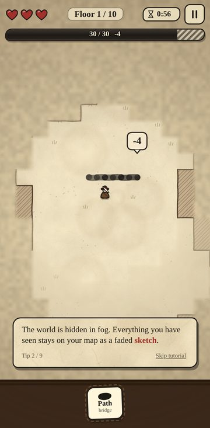
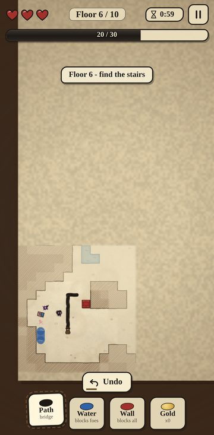
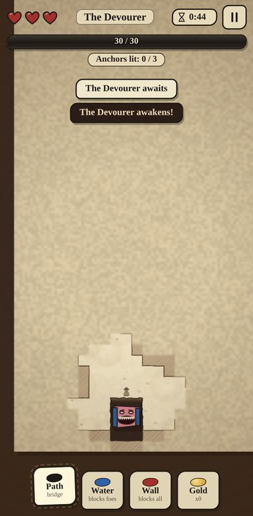

# CARTOGRAPHER

*What you draw becomes real.*

A one-handed, portrait roguelite for Android. You explore a world hidden in fog with a limited
supply of **ink**, and every line you draw with your finger becomes real terrain: a bridge over a
chasm, a river that stops monsters, a wall. A wrong line wastes ink and can trap you; a smart line
is a shortcut. Every minute the world **rewrites itself**, and your ink is the only thing that
stays.

- 10 procedurally generated floors + a boss floor (*The Devourer*, a giant eraser that eats the map)
- Fog of war with a burning-paper reveal; explored areas stay as a faded sketch
- 4 ink types, 16 between-floor upgrades, a meta-progression **Atlas** (pages, unlocks, outfits)
- Hand-drawn parchment look, procedural sound and haptics. There are **no image or audio assets**:
  everything is generated at runtime.
- Built with **Vite + vanilla JS (Canvas 2D)** and wrapped with **Capacitor 8** as a native Android app.
  It's locked to portrait, targets 60 FPS and works fully offline.

<p align="center">
  
  
  
  
</p>

---

## Controls (one hand)

| Gesture | Action |
|---|---|
| **Tap** | Walk there (A* pathfinding; routes around enemies you can see) |
| **Press, hold, then drag** | Draw with the selected ink. The stroke snaps to the tile grid and becomes terrain when you lift your finger |
| **Quick swipe** | Look around |
| **Two-finger pinch** | Zoom |
| **Undo button** | Cancels the last stroke within 2 s and refunds 50 % |

While drawing, a bubble above your finger shows the **ink cost** (1 per tile). It turns **red** when
you can't afford the stroke, and only the affordable part is drawn.

### Inks

| Ink | Effect | Unlock |
|---|---|---|
| **Black** | Path / bridge: walkable, crosses chasms and water | always |
| **Blue** | Water: Smudges can't cross it, and it puts out fire | Atlas, 10 pages |
| **Red** | Wall: blocks enemies, ink blots and you | Atlas, 25 pages |
| **Gold** (rare) | Burns away fog around each drop and marks the stairs | Atlas, 45 pages |

### The world

Floors are **40 × 60 tiles**: ground, chasm, water, rock, ruins, ink pools (refill ink), chests
and the stairs down. Every **60 s** (see the timer) a **rewrite wave** sweeps the page. Every tile
you **can't currently see** and **haven't inked** is regenerated, and fog rolls back over it.
Ruins, the stairs and your ink are stable. So you have to choose between inking a route now to
secure it and saving the ink.

### Enemies (no combat: avoid, block, trap)

- **Smudge**: wanders and chases on sight. It can't cross water. After landing a hit it backs off
  for a few seconds.
- **Eraser** (floor 3+): hunts your ink and rubs it out tile by tile. A bridge you stand on can
  vanish under you.
- **Scribbler** (floor 5+): scribbles walls across your path. From floor 7 it also flicks ink
  blots, which red walls block.
- **Fire** (floor 3+): starts in rewritten areas, spreads over dry ground and burns black ink.
  Blue ink puts it out.
- **The Devourer** (floor 11): light 3 anchors to unseal the stairs while it eats the map into
  chasm. Red walls stall it and water slows it.

**Trap tip:** draw a bridge, let a Smudge step onto it, and hit **Undo**. The Smudge falls.

You have **3 hearts for the whole run**. When you die you keep the **Pages** you found, and you
spend them in the Atlas.

---

## Build the APK on Windows

### 1. Install the tools (one time)

1. **Node.js 22 LTS or newer**: <https://nodejs.org>
2. **Android Studio** (latest stable): <https://developer.android.com/studio>
   - On first launch, let the setup wizard install the Android SDK.
   - Open *More Actions > SDK Manager* and make sure these are installed:
     - *SDK Platforms*: **Android 16 (API 36)**
     - *SDK Tools*: **Android SDK Build-Tools 36**, **Android SDK Platform-Tools**
3. Point your terminal at the SDK and at the JDK 21 that ships with Android Studio. In
   **PowerShell**:

   ```powershell
   setx ANDROID_HOME "$env:LOCALAPPDATA\Android\Sdk"
   setx JAVA_HOME "C:\Program Files\Android\Android Studio\jbr"
   ```

   Then **close and reopen** the terminal. Check that `java -version` reports version 21.

### 2. Build

```powershell
git clone https://github.com/noobiedoggie/CARTOGRAPHER.git
cd CARTOGRAPHER
npm install
npm run build
npx cap add android
npx cap sync android
cd android
.\gradlew.bat assembleDebug
```

`npx cap add android` creates the native project. A post-sync hook (`scripts/patch-android.mjs`)
then automatically:

- locks the app to portrait,
- sets the parchment launch theme and splash,
- generates the compass-rose launcher icons.

You only need `npx cap add android` once. After changing the game code, just run:

```powershell
npm run build
npx cap sync android
cd android
.\gradlew.bat assembleDebug
```

(On macOS/Linux use `./gradlew assembleDebug`. `npm run apk` does all three steps on macOS/Linux.)

### 3. Where the APK ends up

```
android\app\build\outputs\apk\debug\app-debug.apk
```

### 4. Install it on your phone

- **USB:** enable *Developer options > USB debugging* on the phone, plug it in, then run:

  ```powershell
  & "$env:ANDROID_HOME\platform-tools\adb.exe" install -r app\build\outputs\apk\debug\app-debug.apk
  ```

- **Or** copy `app-debug.apk` to the phone and open it. You'll need to allow installing apps from
  that source.

### Troubleshooting

| Problem | Fix |
|---|---|
| `SDK location not found` | Create `android\local.properties` with `sdk.dir=C:\\Users\\<you>\\AppData\\Local\\Android\\Sdk` |
| `Unsupported class file major version` / Gradle won't start | `JAVA_HOME` must point to **JDK 21** (Android Studio's `jbr` folder) |
| `android platform already exists` | The project is already added. Skip `npx cap add android` and just `npx cap sync android` |
| Old icon or splash after an update | Run `npx cap sync android` again (it re-applies the patch), then rebuild |
| You can also open the project in Android Studio | `npx cap open android`, then *Build > Build APK(s)* |

---

## Develop and test in a browser

```bash
npm install
npm run dev        # http://localhost:5173 - mouse works too: hold+drag to draw, wheel to zoom
npm test           # unit + simulation tests (node:test)
npm run balance    # headless "skilled bot" plays full runs and reports the win rate
```

### Tests

- **Generator**: 440 floors (all floor types × 40 seeds) are validated. Each one has a reachable
  exit within its ink-cost band, a free ink pool, a solid border and, on the boss floor, reachable
  anchors.
- **Bot clears every floor**: a solver-guided bot plays floors 1–11 through the real game API
  (tap-to-walk and ink strokes).
- **Rewrite waves**: with a wave every 4 s, the bot still reaches the stairs. Player ink survives
  waves, and after a wave the exit is reachable with the ink in hand.
- **Enemy soak**: 90 s of random play on every floor with all enemies, checking the core
  invariants.
- **Meta**: purchases, perks, upgrade rolls, run snapshots.

### Balance

`npm run balance` runs a bot that knows the cheapest route, detours to ink pools when low, and
throws water or walls in front of chasing Smudges. It dodges poorly and uses no advanced tricks.
Current numbers:

| Setup | Bot win rate |
|---|---|
| All inks unlocked (150 runs) | **~17 %** |
| Black ink only (100 runs) | ~14 % |

Runs mostly end between floors 6 and 10. A skilled human should land around **1 win in 5**. The
first runs are harder until blue and red ink are unlocked. All balance knobs live in
[`src/config.js`](src/config.js).

---

## How it works

### Procedural floors (`src/world/generator.js`)

1. **Cellular automata** (4-5 rule) carve organic caves out of solid rock.
2. Meandering **rifts** (chasms or rivers) cut across the whole width, so the stairs can never be
   reached without ink. Their width varies, and finding a narrow crossing is the reward for
   exploring.
3. Lakes and ruins are added, and tiny pockets are filled in.
4. The start is placed near the bottom and the stairs near the top.
5. A **0-1 BFS solver** (`src/world/solver.js`) computes the exact minimum ink needed to reach
   the stairs. A floor is regenerated unless that cost falls inside a per-floor band. Too cheap
   and ink wouldn't matter; too expensive and the floor would be unfair.

### Rewrite waves (`src/game/rewrite.js`)

The wave builds 8 candidate worlds and keeps the first one in which the stairs are reachable
**with the ink you currently hold**. After the sweep it re-checks from your position. If needed,
it digs a passage through hidden rock or conjures a fresh ink pool, so a floor is never unwinnable.

### Rendering (`src/render/`)

- Terrain is drawn into cached 10×10-tile chunks that are re-rendered only when tiles change.
- The fog is a 4-pixels-per-tile RGBA bitmap, magnified with smoothing. The burning-paper reveal
  is a noise threshold that advances per tile.
- Parchment, grain, vignette, sprites and icons are all procedural.
- Adaptive quality drops the grain overlay, and then resolution, if a device can't hold 60 FPS.

---

## Project structure

```
index.html                 app shell (canvas + HUD/menu overlays)
capacitor.config.json      Capacitor 8 config (appId com.cartographer.game, immersive system bars)
vite.config.js
scripts/
  patch-android.mjs        post-sync hook: portrait lock, splash, generated launcher icons
  balance.mjs              headless balance harness
src/
  main.js                  app shell & roguelite loop (menu -> run -> upgrades -> summary)
  config.js                ALL balance numbers
  styles.css               parchment UI
  core/   rng · camera · input (tap / hold-drag / swipe / pinch) · audio (Web Audio) ·
          haptics (Capacitor Haptics) · storage (Capacitor Preferences) · events
  world/  tiles · world grid · generator · solver · A* pathfinding · vision
  game/   game (one floor) · player · ink strokes · enemies · hazards (fire) ·
          rewrite waves · boss floor · run state · upgrades · meta (Atlas)
  render/ renderer · terrain painter · ink painter · fog · sprites · effects · paper textures
  ui/     HUD · screens · tutorial · feedback (events -> particles/sound/haptics) · icons
tests/                     node:test suites + headless bot helpers
```

Saving uses **@capacitor/preferences** (SharedPreferences on Android, localStorage in the browser).
Meta progress is saved after every change. The current run is snapshotted at every floor start
and on every lost heart, so **Continue** resumes your expedition.
